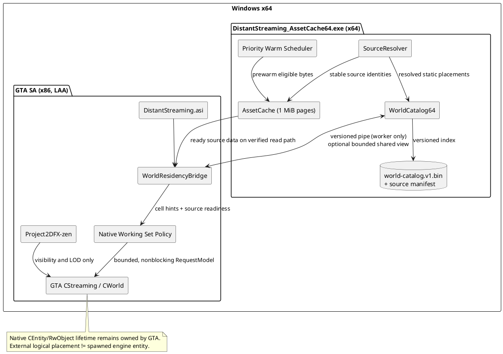

# SPEC-1-DistantStreaming-World-Residency

**Status:** Proposed architecture / not yet implemented  
**Target:** GTA San Andreas 1.0 US (supported HOODLUM executable), Windows x64 host, LAA-enabled x86 GTA, compatible Open Limit Adjuster and Mod Loader.  
**Project baseline:** `DistantStreaming_without_DrawDistance` from the uploaded project; x86 ASI + x64 `DistantStreaming_AssetCache64.exe`.  
**Design:** A + C — *complete logical world catalog and externally cached asset sources; bounded on-demand native materialization*.

## Background

DistantStreaming currently has a native game-side streaming controller, x86 memory policy, an x64 source-byte cache with 1 MiB pages, native-archive/Mod Loader observation, OLA table binding, and safety checks. In the prior runtime capture, the helper connected but native `CdStreamRead` ready-hit substitution was disabled; the capture does not prove whole-world cache effectiveness. The existing `[AssetPreload]` facility explicitly avoids unlimited native `CreateRwObject()` calls, and is not a suitable basis for "all native objects loaded" mode.

Project2DFX-zen owns draw distance, LOD visibility, far clip, and effects. Its October 19, 2026 changelog also describes optional category preloading. DistantStreaming must not recreate its renderer or visual-distance controls.

**Physical invariant:** A 32-bit Large Address Aware GTA process on x64 Windows still has at most ~4 GiB of user-mode virtual address space. An external x64 process can retain world metadata and raw asset bytes, but cannot make GTA's RenderWare pointers address that memory directly. "Logically spawned" here means the placement exists in an external, queryable catalog. It does **not** mean a GTA `CEntity` or `RwObject` has been created for every placement, nor that distant collision/AI/mission scripts run globally.

## Requirements

### Must
- **M-01:** Build a complete *catalog of supported static placements* (normal, generic, vegetation, buildings, timed, LOD) and their asset-source dependencies, including a provenance/coverage report. Never silently claim 100% if a file format or Mod Loader override cannot be resolved.
- **M-02:** Keep this logical world catalog and eligible raw source pages in x64 memory/disk-backed cache outside GTA's x86 virtual address space.
- **M-03:** Keep only a measured, bounded model/resource/instance working set in GTA. Respect original GTA streaming ownership, mission-required/keep flags, cutscenes, time/area state, and OLA table moves.
- **M-04:** Retain Project2DFX as the sole draw-distance/visibility/LOD-rendering owner. No renderer hooks, far-clip changes, `CEntity::CreateRwObject()` forced across the whole map, or Project2DFX source modifications for the MVP.
- **M-05:** No disk I/O, pipe waits, model decode, or forced `LoadAllRequestedModels()` from `CdStreamRead`/Mod Loader hooks or the game/render thread.
- **M-06:** Fail open to vanilla streaming on helper timeout, stale catalog, unsupported build, modified source, memory pressure, and protocol mismatch.
- **M-07:** Fingerprint effective Mod Loader/archive sources and invalidate changed pages/placements. Never claim an override is effective based only on a filesystem scan.
- **M-08:** Offer an independently disabled-by-default `[WorldResidency]` feature flag, tested isolated from the legacy whole-model preloader.
- **M-09:** Capture per-run catalog coverage, cache-hit/served-byte metrics, native active model count, free virtual address space, queue depth, frame P50/P95/P99, pop-in, and correctness failures.

### Should
- **S-01:** Pre-cache most/all *eligible source bytes*, constrained by actual available system RAM; retain full catalog metadata even when cache eviction is necessary.
- **S-02:** Prioritize cells ahead of motion and recently requested models; coalesce duplicate native `RequestModel` calls.
- **S-03:** Adapt native request admission to free x86 VA, streaming headroom, game backlog, native frame time and GPU memory pressure.
- **S-04:** Keep cold catalog output as a validated, versioned on-disk index to reduce future scan cost.
- **S-05:** Detect and avoid overlapping whole-map/category preloading with Project2DFX's optional preload facilities.

### Could
- **C-01:** Shared-memory descriptors for large, completed cache results, with a small bounded x86 view.
- **C-02:** Optional read-only plugin-to-plugin hinting if Project2DFX adds a versioned interface in the future.
- **C-03:** Content-deduplicate identical source pages and support a disk-backed compressed cold cache after the native path is proven.

### Won't (MVP)
- **W-01:** Instantiating every `CEntity`, collision, physics, AI and high-detail RW object simultaneously in GTA.
- **W-02:** Migrating GTA's game pointers, decoded RenderWare objects, or managed D3D9 resource backing transparently into the helper.
- **W-03:** Replacing Project2DFX's renderer or taking ownership of LOD selection.
- **W-04:** Automatic binary IPL parsing or arbitrary mod archive handling without a validated format and precedence test.

## Method

### 1. Logical and physical architecture



**Ownership rules**
1. `WorldCatalog64` owns *static metadata*, not `CEntity*`, `RwObject*`, or GTA streaming state.
2. `AssetCache` owns immutable source pages; no remote game object pointers.
3. The ASI may request models, but GTA remains the authority on loaded/requested/not-loaded state and entity creation.
4. Project2DFX owns which assets are rendered. DistantStreaming never changes draw distance or creates new world visibility lists.

### 2. World catalog builder

**Startup / rebuild flow:**
1. Obtain game root and archive registrations via existing observable source paths; determine live source identities using file ID, size, modification time, archive record offsets and Mod Loader's *observed* effective read paths where available.
2. Parse `gta.dat`/registered level definitions, supported text IDE records and text IPL `inst` records, plus LOD relationships and interior/area/time flags. Binary IPL and unsupported modded formats stay `UNRESOLVED` until separately validated.
3. Categorize models from *definitions/source provenance* (normal, generic, vegetation, timed, LOD, building), without altering Project2DFX's visibility classifications. Unclear category => `UNKNOWN`, still cataloged if parseable.
4. Build a stable identifier `placement_id = H(source_identity, archive_entry, ordinal, version)`. Never use x86 pointers or raw GTA model IDs as persistent identity.
5. Index every placement into an independent spatial grid (proposal: `floor(x/256)`, `floor(y/256)` in GTA units), **not** into Project2DFX's renderer grid.
6. Resolve effective model dependencies: IDE name -> effective model source, optional TXD hierarchy/dependencies, collision and animation references where verified. Mark unresolved dependency edges explicitly.
7. Publish a **complete immutable generation**. Never expose partially built generations. Regenerate when manifest changes.

**Important limit:** Static placement files do not authoritatively describe the *current live engine world*. Script-created objects, vehicles, peds, missions, destructible/moving objects and transient IPL activation remain GTA-owned and are outside this catalog.

**Catalog file layout (proposed, no new database dependency):**

All integers little-endian, files validated before mapping, arrays contiguous and referenced by 64-bit **relative offsets**, never absolute pointers. Reject invalid bounds/counts, duplicates and unsupported schema versions. Include a CRC/content fingerprint for index integrity and a manifest fingerprint for source invalidation.

| Record | Fields |
|---|---|
| `CatalogHeaderV1` | magic `DSWC`, schema `1`, minimumReaderVersion, fileBytes, manifestFingerprint[32], modelCount, placementCount, cellCount, sourceCount, offsets and lengths for each array |
| `SourceV1` | sourceId u64, pathStringOffset u64, canonical file identity/fingerprint, size u64, effectiveOverrideState enum, archiveEntryOffset u64, archiveEntryBytes u64 |
| `ModelV1` | modelKey u64, nameStringOffset u64, engineModelIdHint i32 (**not** trusted without live rebind), category u16, flags u16, DFF/TXD/COL source IDs and offsets, dependency index/count |
| `PlacementV1` | placementId u64, modelKey u64, x/y/z f32, quaternion x/y/z/w f32, area i16, flags u16, timeOn/timeOff u8, LOD placement reference u64, cellId u32, sourceId u64, source record ordinal u32 |
| `CellIndexV1` | cellX i32, cellY i32, placementFirst u64, placementCount u32, representative bounds for proximity query |
| `DependencyV1` | source model key u64, target model/source key u64, kind enum (TXD, COL, ANIM, LOD), validated-state enum |

Exact packed structures must use fixed-width types and `static_assert(sizeof(...))`; offsets/bounds checks and test vectors must precede accepting real untrusted mod files. For strings use a counted UTF-8 table; do not embed `std::string` in serialized records. One source ID must not be conflated with a model ID.

**Integration caveat:** Not every modded map/override can be fully indexed via vanilla `gta.dat`/text IPL parsing. MVP coverage is reported as `resolved / discovered`, with unresolved records and unsupported source families visible in telemetry, rather than guessed.

### 3. Native working set and prediction

Maintain a tiny, bounded in-process state table keyed by *validated live model IDs*:

```cpp
enum class NativePhase : uint8_t { Unknown, Candidate, Requested, Loaded, Cooling };
struct ModelTicket {
    int32_t modelId;                  // validated against live OLA arrays
    uint32_t generation;              // model-table / catalog generation
    uint32_t lastNativeDemandMs;
    uint32_t lastPredictedMs;
    uint32_t cooldownUntilMs;
    NativePhase phase;
    bool pluginOwnsPin;               // never release foreign/mission pins
};
```

**Algorithm per scheduler tick** (proposal: `WorldResidency.TickMs=120`, global CPU allowance `500us`, 4 requests/tick initially):

```text
if helper down OR catalog generation mismatch:
    stop speculative catalog requests; use existing native path
if !gameplaySafe OR !OLA bindings valid OR native streaming uninitialized:
    pause; do not traverse game objects

snapshot player position, camera direction, approximate velocity and memory
query cells containing player + short predicted motion path (helper worker)
merge cell model IDs + recent native RequestModel demand
resolve model names/IDs ONLY via a separately validated name-to-live-ID resolver and live OLA model tables
discard unsupported IDs, mission-only, interior-mismatched and inapplicable time models
skip models already LOADED/REQUESTED/CHANNELED by GTA; never duplicate native pending work
dedupe by validated model ID (not by placement count)

score(model):
    1000 if native recent demand, else
    250 if ahead in near future, else
    100 if nearby, else 0
    - 20 * estimated cost MiB
    - penalties for older/stale prediction or unknown dependencies

if freeVA < 1280 MiB OR streamingUsed >= 85% of effective native budget
   OR nativeBacklog > 64 OR frame guard active OR GPU pressure critical:
    admit 0 requests; gradually release ONLY plugin-owned optional pins
else:
    issue at most 4 nonblocking CStreaming::RequestModel(...) per tick
    (optional temporary KEEP_IN_MEMORY only for very small bounded protected set)
```

**Engineering note:** The values above are **initial tunables, not validated optimal settings**. Use hysteresis (resume when free VA >1536 MiB and below the native high-water mark). Native streaming and Project2DFX remain free to request required models even while speculative requests are paused. Do not block GTA's own calls.

**Materialization:** Do not force global entity creation. Normal GTA IPL/world streaming creates and destroys real game entities as usual. The catalog's logical objects exist whether or not GTA currently has a corresponding native entity. If the game must load or activate an IPL, let its normal IPL/sector pipeline do so. Do not inject invisible-world entities to make the "spawned" metric look larger.

### 4. IPC and source-page strategy

**Extend rather than replace:** `include/asc/NativeMemoryProtocol.h` (currently v4), `src/service64/NativeMemoryService.cpp`, and `src/game/AsyncAssetCacheWin.cpp`.

Proposed v5 command IDs, added after existing commands:
- `CatalogStatus=11` — generation, manifest hash, progress and coverage counters.
- `QueryCells=12` — batched (x,y) tile IDs, returns only capped model-key hints and placement counts; never returns GTA pointers.
- `WarmSourceRange=13` — sourceId + offset + length + priority; worker enqueues, returns immediately.
- `CatalogInvalidate=14` — explicit source-generation recheck.
- `ReadCatalogPage=15` — read-only, capped catalog page to an **already existing** 1 MiB mapping; optional for older IPC clients.

Requests use explicit length + bounded count with validated protocol version and CRC over variable payloads. Keep the session-named pipe and authenticated parent-PID check. The ASI's worker performs all IPC. Game-thread callbacks only enqueue bounded lock-free/low-contention hints and read previously published immutable snapshots.

Existing 1 MiB source pages are the initial bulk transport; the 48 MiB x86 L1 setting remains capped. A 16 MiB shared-view upgrade is optional and **must not** increase total x86 resident consumption accidentally. Source pages may be prewarmed only after observed effective provenance is verified, and native read-through hits must preserve original sync/overlapped channel semantics. If unsafe or unknown, fall through to native GTA / Mod Loader reads.

**Cache capacity:** `min(userCap, measured safe system-RAM allowance)`, where a cap of 8 GiB is only a policy target. If total eligible bytes exceed cap, keep complete logical catalog and use priority/LRU source-page eviction. Counting cached bytes is not the same as measuring saved I/O. Measure `bytesServed`, lookups, misses, cache-warm traffic, native fallbacks and actual latency.

**Win32 basis:** `CreateFileMapping`/`MapViewOfFile` support partial views and can keep a large mapping outside the x86 process. Mapping a view still consumes *x86 virtual address space*; never map the entire helper cache.  
Docs: https://learn.microsoft.com/en-us/windows/win32/memory/creating-a-file-mapping-object and https://learn.microsoft.com/en-us/windows/win32/memory/creating-a-file-view

### 5. Compatibility and fault paths

- **Project2DFX:** Keep rendering/preload settings unchanged by code. Recommend choosing one speculative preloader. For first validation runs, turn off Project2DFX category preloading **and** DistantStreaming `[AssetPreload]` to isolate new world-residency behavior; then test both coexisting with observational request coalescing.
- **Mod Loader:** Resolve observed effective asset source. Do not assume directory-name order implies actual override precedence. On unexpected path/file ID, native fallback plus generation rebuild.
- **Open Limit Adjuster:** Rebind/check live model arrays before reading any model IDs. Handle count changes and out-of-range IDs by pausing predictions, not by clipping to 20,000 silently; support greater-than-vanilla IDs only when every relevant array bound is verified.
- **Helper unavailable:** No catalog lookups or warm jobs; original GTA native streaming continues.
- **Source changed mid-read:** discard stale page, avoid partial publication, increment generation and rebuild.
- **Save/load, teleport, interior changes:** flush prediction queue and bump working-set generation; never flush or remove mission-owned native state.
- **Low memory:** stop speculative native requests first, then release ASC-owned pins, then trim external warm pages according to system pressure. Never forcibly free live model resources to meet an abstract cache target.

### 6. Suggested configuration

```ini
[WorldResidency]
Enabled=0
CatalogStaticWorld=1
CatalogTextIpl=1
CatalogBinaryIplVerifiedOnly=1
IndexCellUnits=256
TickMs=120
MaxQueriesPerTick=8
MaxHintsPerTick=128
MaxNativeRequestsPerTick=4
MaxTickCpuUs=500
StopFreeVaMiB=1280
ResumeFreeVaMiB=1536
StopStreamUsedPercent=85
MaxNativeBacklog=64
NoGlobalNativeInstantiation=1
ReportMs=10000

[AssetPreload]
Enabled=0
PreloadAllAssets=0
ForceWorldInstances=0

[ExternalAssetCache64]
; Keep current established x64 helper and 1 MiB page path.
; Existing SourceReadSubstitution / Mod Loader toggles remain conservative.
```

Leave `Enabled=0` until the first two milestones pass. Project2DFX retains the draw-distance configuration; DistantStreaming adds no `[DrawDistance]` section.

## Implementation

Implement against the *no-drawdistance* branch in this order:

1. Add `include/asc/WorldCatalogFormat.h`, `include/asc/WorldResidencyPolicy.h`, `tests/world_catalog_*`, `tests/world_residency_policy_tests.cpp` as platform-independent code with adversarial bounds/fuzz corpus.
2. Add `src/service64/WorldCatalog64.h/.cpp`, `SourceResolver64.h/.cpp`, `WorldCatalogStore64.cpp` to **x64 helper target only**; begin with native supported text IPL/IDE and explicit unresolved audit output.
3. Add `CatalogStatus` and `QueryCells` to v5 protocol, with protocol-size compatibility tests. Upgrade ASI and helper **together**; mismatched binaries fail to native behavior.
4. Add game-side `src/game/WorldResidencyWin.h/.cpp`, worker queue and read-only snapshot publication to ASI build. Reuse `ola_bindings::StillBound()`, `asc::Snapshot` and request coalescing; issue only on safe game callbacks.
5. Wire `[WorldResidency]` from `src/game/ConfigWin.cpp`, drive ticks from `src/game/main.cpp`, report metrics through existing telemetry. Keep `[AssetPreload]` separate and disabled during initial tests.
6. Add source warm hints to the existing `AssetCache` (1 MiB pages, existing limit). Do not enable unsafe `CdStreamRead` ready-hit substitution simply because pages are cached.
7. Validate effective Mod Loader overrides with real file provenance fixtures; add **validated** binary IPL support only afterward.
8. Build x86 ASI/x64 helper on Windows; run protocol, helper disconnect, hot source modification and compatibility test matrix; then in-game pilot.

## Milestones

| Milestone | Deliverable | Gate |
|---|---|---|
| M1 — Catalog | Standalone x64 catalog, provenance, load-graph and spatial index | 100% pass of supported parser fixture corpus; real-world coverage reported, unknowns explicit |
| M2 — IPC | Versioned catalog query worker, immutable ASI snapshots | No game-thread waits or crashes under helper kill/restart and corrupted inputs |
| M3 — Safe prefetch | Native model-ticket scheduler with pressure admission | No whole-world native instance creation; no worsening of mission/teleport/save-load correctness |
| M4 — Cache64 residency | Verified demand/warm source pages, provenance invalidation | Measurable bytes served / native reads saved; correct native fallbacks |
| M5 — Coexistence | Project2DFX + Mod Loader + OLA validation | No draw-distance ownership, foreign detour conflicts or duplicate request storms |
| M6 — Release | Win32/x64 CI, packaging, logs and comparison profile | No crashes over repeated drive/fly/teleport tests and frame P95/P99 not regressed relative to agreed baseline |

## Gathering Results

**Record every 1–10 seconds:** catalog generation; discovered/resolved/unresolved model, source and placement counts; tile coverage; source page resident bytes; cache served/disk/warm bytes; native request issue/coalescing; loaded/native outstanding; native memory and free VA; GPU WDDM pressure; P50/P95/P99 frame times; helper recovery/fallbacks.

**Acceptance tests:**
- Cold start + second start, with unchanged and modified archives.
- Vanilla SA map; text IPL and modded vegetation/generic/normal placement fixtures; OLA extended model IDs; Mod Loader replacement and multiple archive sources.
- 30-minute drive and flight, 10 rapid teleports, interior transitions, save/load, cutscene, time-of-day transitions.
- Live helper kill/restart and version mismatch.
- A/B/C conditions: current DistantStreaming with WorldResidency off; WorldResidency on and Project2DFX preload off; WorldResidency on with Project2DFX preload on (compatibility).
- Confirm no added DistantStreaming distant draw calls; Project2DFX draws remain solely its responsibility.

**Outcome interpretation:** success means the *logical world* is fully cataloged where supported, most eligible asset bytes are externally cached when RAM permits, and GTA's **needed** working set becomes available more predictably with no regressions. It does not mean every object is simultaneously allocated as a native `CEntity`/`RwObject`.

## Need Professional Help in Developing Your Architecture?

Please contact me at [sammuti.com](https://sammuti.com) :)
