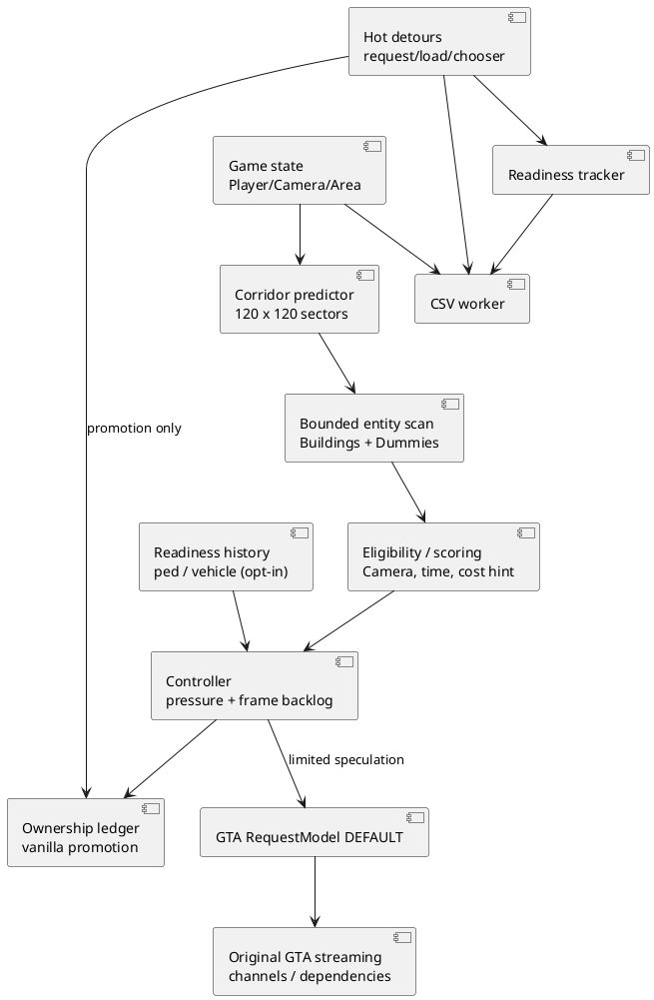

# SPEC-2-Independent-DistantStreaming-Advanced

## Background

Vanilla GTA SA 1.0 US has low-level streaming state, channels, TXD / DFF
dependencies, resource loading, and eviction. DistantStreaming is a
**standalone additional request scheduler** intended to reduce late resource
requests while keeping memory use bounded. It is explicitly not a continuation
of LoadWholeMap and does not contain its bulk-loading features.

## Requirements

The later user-requested [camera catch-up mode](CAMERA_CATCHUP.md) explicitly
adds a configurable synchronous priority-loader exception to the original
asynchronous policy below. It also creates native render objects for existing
loaded map entities. It does not add mission-required pins or whole-map loading.

- **MUST R1:** No duplicated LoadWholeMap code,
  forced cleanup, range pinning, IPL, animation or synchronous bulk loaders.
- **MUST R2:** Always forward vanilla `RequestModel` calls unchanged.
- **MUST R3:** Preserve loading-thread / RenderWare affinity and GTA internals.
- **MUST R4:** Apply strict 32-bit executable and hook-address guardrails.
- **MUST R5:** Reject prefetch under unsafe game state or memory pressure.
- **SHOULD R6:** Capsule prediction covering current and future sectors.
- **SHOULD R7:** Rank globally across a bounded scan, with camera + time gates.
- **SHOULD R8:** Avoid churn and maintain speculative provenance safely.
- **SHOULD R9:** Frame-time and read-latency feedback reduces speculation.
- **SHOULD R10:** Buffered model readiness / CPU / memory telemetry.
- **COULD R11:** Learn limited local traffic/ped model popularity.
- **COULD R12:** Instrument archive selection; leave selection unchanged.
- **WON'T R13:** Guaranteed instant spawning/despawning or conversion threading.

## Method

**Sector selection:** clamp to 120x120 50-unit cells, select candidates
near the player-to-future segment, score distance to path/current/predicted
position, globally sort, keep max 32 and current cell. Entity collection
inspects at most 4096 linked-list nodes, ranks by view alignment,
time-of-day, approximate draw-distance, arrival proximity and IMG-size
cost hint, then top-128 per model ID. No raw entity pointers persist.

**Memory (updated 2026-10-15):** an independently implemented, optional
LAA-aware manager now writes `ms_memoryAvailable`; see
[streaming memory policy](STREAMING_MEMORY.md). Other memory data comes from
`GlobalMemoryStatusEx`, `GetProcessMemoryInfo`. Controller normal (below
75%), throttled (from 75%), critical (from 85%, private RAM or low system
memory), resume below 70%. Address-space pressure also blocks speculation.
No forced evictions; outstanding vanilla engine
requests are never blocked.

**Ownership:** `OnVanillaRequest` marks speculative model as promoted;
request hook never changes flags. Refresh demand BEFORE admission,
then expire stale ledger entries with cooldown. Expiry removes ledger
records only, not native models. Per-model request observations coalesce
repeats and retain deferred records without overflow-driven ledger resets.

**Dynamic readiness:** Learn only locally observed vanilla ped/vehicle
requests. Experimental default OFF; same-area 150 unit radius / 10s
history, at most one speculative request per tick, and the normal memory
and engine-backlog checks. Does not spawn or destroy entities.

**Deep hooks:** `RequestModel(0x4087E0)` and
`LoadRequestedModels(0x40E3A0)` are instrumented. Optional
`GetNextFileOnCd(0x408E20)` profiling is OFF by default and calls
its original trampoline unchanged. Core stream channel or archive
selection code is never overwritten.

**Latency:** sample CStreamingInfo states; queue and end-to-end
request-to-loaded values are lower-resolution approximations
(scheduler tick granularity). This is *asset readiness* not entity spawn
latency. Actual FPS, pop-in and vehicle creation must be benchmarked
in game.

## Implementation

- `include/asc/Core.h`, `src/core/Core.cpp` — portable policy.
- `src/game/GameAdapter.cpp` — world sector traversal and filters.
- `src/game/Hooks.cpp` — atomic per-model observations plus MinHook detours.
- `src/game/Readiness.cpp` — queued, channel, finish, loaded telemetry.
- `src/game/Telemetry.cpp` — render-event frame sampling and file worker.
- `src/game/main.cpp` — integration, transitions, promotion.
- `config/DistantStreaming.ini` — tuning, no overlapping settings.
- `tools/audit_separation.py` — anti-duplication audit.

## Milestones

1. Core policy / capsule / tests — portable test completed.
   Lock-free ring multi-producer stress test completed.
2. Candidate prioritization / eligibility — source completed; game validation open.
3. Lock-free hooks / archive profiling — source completed; game validation open.
4. Ped/vehicle readiness sampling and opt-in warmup — source completed;
   game validation open.
5. MSVC 2026 x86 compilation and GTA SA stress test — **not done here**.
6. Objective latency / frame time benchmarks — **not done here**.

## Gathering Results

Use separate repeated routes, identical saves and graphics settings.
Compare frame p95/p99, max draw spike, missing assets, model request
lateness, streamed memory, process memory, and script compatibility.
Successful outcome requires no new crashes, no required-model stalls,
and measured improvement. Worker logging drop counters must be zero.

## Need Professional Help in Developing Your Architecture?

Please contact me at [sammuti.com](https://sammuti.com) :)
